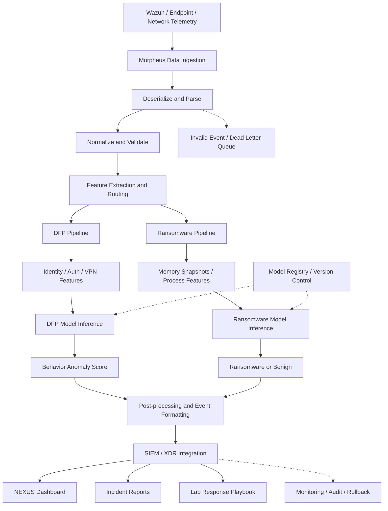

> **SUPERSEDED — 2026-11-05:** Current owner scope is Agent003 endpoint behavior without BlueField and human-reviewed recommendations. Read [architecture v2](EDRXDR-ENDPOINT-HUMAN-REVIEW-v2-20261105.md) and [current handoff](../../training/HANDOFF-PROJECT-NEXUS-ENDPOINT-20261105.md). The historical text below is preserved; it is not authorization to run collectors, train models or execute responses.

# EDRXDR–Morpheus–NEXUS
# Target Architecture v1
## DFP + Ransomware Detection

- Document status: ACTIVE TARGET ARCHITECTURE
- Version: 1.0
- Date: 2026-11-05
- Repository branch: work/nexus-exact-ai-v1

---

## 1. Architecture Decision

This document is the authoritative target architecture for
EDRXDR–Morpheus–NEXUS.

The active detection architecture consists of two independent AI pipelines:

1. DFP — behavioral anomaly detection.
   Detect abnormal user/account behavior using identity, authentication,
   VPN and relevant endpoint telemetry.

2. Ransomware Detection — Process-level ransomware classification.
   Classify compatible process and memory snapshot evidence as
   ransomware or benign, using a verified feature contract aligned
   with NVIDIA DOCA AppShield.

The outputs of both pipelines are integrated into the shared
SIEM/XDR event-processing path and presented through NEXUS.

BERT v4 is superseded as the active target detection architecture.
Its code, datasets, weights, checkpoints, evaluation evidence and
historical documentation MUST remain preserved and unchanged.

This document describes the target design. It does not claim that
all components are implemented, validated or production-ready.

---

## 2. High-Level Architecture

---

## 3. Data Ingestion Layer

Morpheus receives telemetry from authorized sources:

- Wazuh alerts and relevant archive events.
- Linux and Windows endpoint telemetry.
- Identity and authentication logs.
- VPN activity.
- Network telemetry where available and authorized.
- Compatible process and memory snapshot telemetry.

Responsibilities:

- Receive and deserialize incoming events.
- Parse source-specific formats.
- Preserve source provenance and timestamps.
- Validate required fields.
- Handle malformed, incomplete and unsupported records.
- Preserve event identity and prevent unintended duplicate processing.

A missing source or unavailable field MUST NOT be interpreted
as evidence of benign behavior.

---

## 4. Normalize and Validate

Normalize incoming data into versioned internal schemas.

Required considerations:

- Timestamp and timezone normalization.
- Source and endpoint identity.
- Event provenance.
- Field type validation.
- Missing-field representation.
- Duplicate and replay handling.
- Schema version compatibility.

Do not silently change existing event UID contracts.

Do not fabricate missing observation windows or zero-pad
unobserved telemetry.

Invalid events must be isolated for review rather than
silently discarded.

---

## 5. Feature Extraction and Routing

Feature extraction must be separated by detection purpose.

DFP and Ransomware MUST NOT share an assumed universal
feature vector.

Each pipeline must define:

- Feature schema version.
- Feature names and ordering.
- Source-to-feature mapping.
- Missingness policy.
- Data type and range validation.
- Entity and event identity.
- Feature provenance.

The routing layer sends only compatible records to the
appropriate detection pipeline.

---

## 6. Pipeline A — DFP

### 6.1 Objective

Detect abnormal user and account behavior.

### 6.2 Input Features

- Identity and account activity.
- Authentication success/failure patterns.
- VPN login and session activity.
- Relevant endpoint behavior.
- Temporal and behavioral baselines.

### 6.3 Processing

1. Resolve source and entity identity.
2. Validate event membership and coverage.
3. Extract behavioral features.
4. Apply the approved feature schema.
5. Run DFP model inference.
6. Produce a behavioral anomaly score.

### 6.4 Output

- Entity reference.
- Observation window.
- Anomaly score.
- Model version.
- Feature schema version.
- Evidence references.
- Detection timestamp.

An anomaly score is not automatically a calibrated
threat probability or confirmed malicious label.

### 6.5 Acceptance Requirements

- Independently verified endpoint identity.
- Verified source exposure and capture coverage.
- Representative baseline activity.
- Versioned feature contract.
- Chronological independent evaluation.
- Defined nuisance-alert and performance criteria.
- Repeatable CPU inference.
- Shadow integration and rollback evidence.

---

## 7. Pipeline B — Ransomware Detection

### 7.1 Objective

Classify process behavior as:

- Ransomware
- Benign

### 7.2 Input Features

- Compatible memory snapshots.
- Process-level telemetry.
- Process identity and snapshot metadata.
- NVIDIA DOCA AppShield-aligned features.

The intended feature contract contains 297 features.
The exact feature order, definitions, source mapping and
compatibility MUST be verified against trusted provenance.

Wazuh/FIM event counts are not substitutes for AppShield
memory/process features.

### 7.3 Processing

1. Validate snapshot and process identity.
2. Verify input compatibility.
3. Extract the approved feature vector.
4. Validate feature count and ordering.
5. Load the approved model artifact.
6. Run ransomware model inference.
7. Produce classification and supported score metadata.

### 7.4 Output

- Process reference.
- Snapshot reference.
- Classification.
- Model artifact version.
- Feature schema version.
- Evidence references.
- Detection timestamp.

### 7.5 Acceptance Requirements

- Trusted model and class-mapping provenance.
- Compatible real endpoint telemetry.
- Verified 297-feature contract.
- Independent ransomware/benign evaluation.
- False-positive and false-negative analysis.
- CPU/GPU compatibility evidence as applicable.
- Resource and latency measurements.
- Shadow integration and rollback evidence.

Sample replay alone does not establish real-world detection
accuracy or production readiness.

---

## 8. Model Registry and Version Management

Both detection pipelines must maintain independent model records.

Required metadata:

- Model identifier.
- Model version.
- Model artifact hash.
- Feature schema version.
- Training data provenance.
- Evaluation protocol.
- Evaluation results.
- Deployment status.
- Approval status.

Model replacement must be versioned and reversible.

No model should be silently substituted in an active pipeline.

---

## 9. Post-processing and Event Formatting

Both pipelines produce results for a common event-processing layer.

The shared event envelope should contain:

- event_id
- event_time
- detection_type
- source_reference
- entity_reference
- model_id
- model_version
- feature_schema_version
- detection_result
- score_semantics
- evidence_reference
- processing_status

Pipeline-specific fields must remain distinguishable.

Post-processing responsibilities:

- Validate detection outputs.
- Normalize event metadata.
- Preserve model provenance.
- Handle duplicate delivery.
- Correlate related events.
- Produce SIEM/XDR-compatible events.

---

## 10. SIEM / XDR Integration

Morpheus publishes validated detection events to the
approved SIEM/XDR integration path.

NEXUS consumes these events for:

### NEXUS Dashboard
- DFP behavioral anomalies.
- Ransomware classifications.
- Detection timelines.
- Entity and endpoint views.
- Model and pipeline status.

### Incident Reports
- Detection evidence.
- Event timelines.
- Source provenance.
- Model version.
- Investigation status.

### Lab Response Playbook
- Investigation recommendations.
- Approved response procedures.
- Audit records.
- Manual response workflow.

Automated response remains disabled until a separate
approval and acceptance process is completed.

---

## 11. Reliability, Security and Monitoring

The target implementation must include:

- Dead Letter Queue for invalid events.
- Retry and idempotency controls.
- Source coverage monitoring.
- Feature validation monitoring.
- Model inference health monitoring.
- Latency and resource monitoring.
- Audit logging.
- Model rollback.
- Pipeline isolation.
- Access control and sensitive-data protection.

Production response requires approved policies,
allowlists, kill switch and tested rollback procedures.

---

## 12. Implementation Status

The following table distinguishes existing evidence from
future acceptance requirements.

| Component | Current status |
|---|---|
| Morpheus ingestion | Existing infrastructure; full target integration pending |
| DFP prototype | CPU development diagnostic verified |
| DFP identity | Physical identity not independently verified |
| DFP coverage | Independent coverage acceptance pending |
| DFP quality | Independent evaluation not passed |
| Ransomware sample replay | Existing lab evidence |
| Ransomware class mapping | Verification pending |
| AppShield compatibility | Live feature contract verification pending |
| Common event formatting | Target implementation pending |
| NEXUS integration | Existing components; new dual-pipeline integration pending |
| Automated response | Not approved |

Existing DFP diagnostics using twelve windows are not
independent quality evaluation.

Existing Ransomware sample replay is not proof of
live endpoint detection capability.

---

## 13. Delivery and Acceptance Gates

The delivery sequence is:

1. Freeze and approve the architecture and event contracts.
2. Complete DFP source identity and collection coverage.
3. Establish representative DFP baseline and independent evaluation.
4. Verify Ransomware model provenance and class mapping.
5. Verify real compatible AppShield telemetry and feature contract.
6. Implement and test independent pipeline inference.
7. Implement shared post-processing and event formatting.
8. Integrate both pipelines into NEXUS SIEM/XDR.
9. Run shadow evaluation and measure false alerts and latency.
10. Complete security, rollback and operational acceptance.
11. Obtain explicit production approval.

A failed gate blocks dependent production deployment.

Passing a code or integration test does not automatically
mean model quality acceptance.

---

## 14. BERT v4 Supersession and Preservation

BERT v4 is no longer the active detector in this target
architecture.

Its historical artifacts remain preserved for:

- Reproducibility.
- Historical evaluation.
- Audit and provenance.
- Research reference.

No BERT v4 dataset, checkpoint, model artifact or
protected evaluation evidence may be deleted, overwritten
or silently repurposed as DFP/Ransomware evidence.

---

## 15. Architecture Change Control

This document is the single authoritative active target
architecture for EDRXDR–Morpheus–NEXUS.

Future development MUST align with this document.

Architecture changes require:

1. Explicit review.
2. Versioned documentation.
3. Updated acceptance criteria.
4. Git history preservation.

Implementation status must never be inferred from
architecture diagrams alone.
