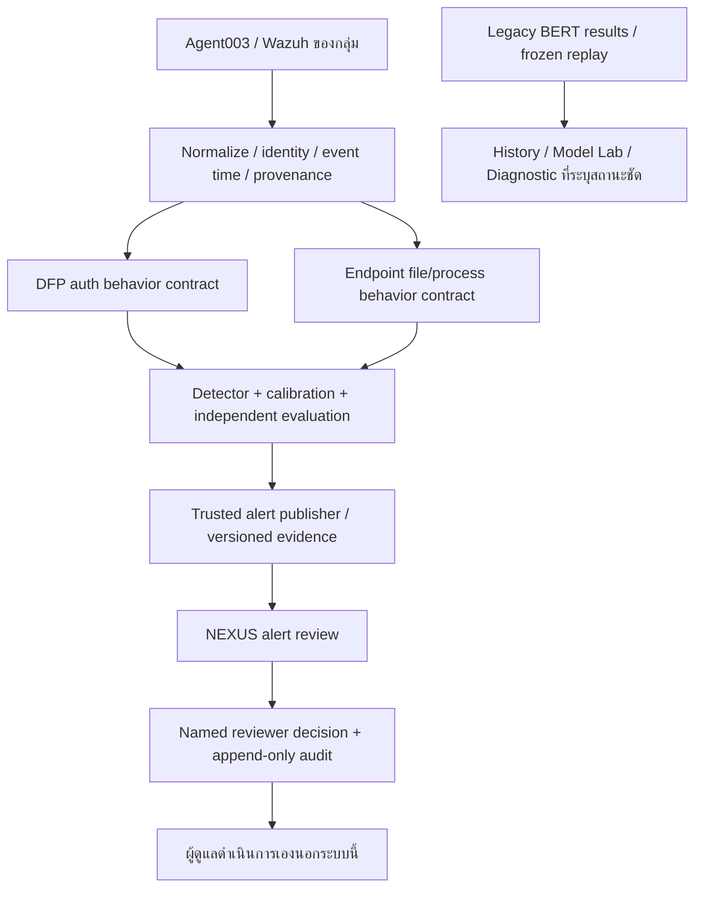

# EDRXDR Target Architecture v2 — Endpoint + Human Review

วันที่ 5 พฤศจิกายน 2026 (Asia/Bangkok)
สถานะ: ขอบเขตล่าสุดที่เจ้าของเลือก แทน target AppShield/BlueField ใน architecture v1; ไม่ใช่การรับรอง production

## ขอบเขตและสถานะ

- Agent003 เป็น endpointแรก; Agent004พัก; network telemetryนอกขอบเขต
- ไม่ใช้BlueField/RShim/DPU/firmware/AppShieldในเส้นทางendpointใหม่
- LLMสรุปผลเลิกใช้ในDashboardรุ่นส่งมอบ; APIเก่าคงไว้ตอบ401/410
- เสนอคำแนะนำและบันทึกการตัดสินใจของคน ไม่มีexecution endpointหรือautoblock
- ยังไม่เลือกโฟลเดอร์ข้อมูลจริงที่จะเฝ้าระวัง; ยังไม่เปิดcollectorหรือFIM coverageใหม่
- DFPและendpoint detectorเป็นคนละcontract ห้ามถือว่ามีuniversal featurevector
- Live BERTเดิมยังไม่ได้ถูกแทน ต้องมีquality/coverage/rollback acceptanceก่อนcutoverแยก

## เส้นทางเป้าหมาย

## สิ่งที่มีและสิ่งที่ยังต้องทำ

| ส่วน | หลักฐานจริง |
|---|---|
| Existing ingestion/History | มีโครงสร้างและการอ่านข้อมูลเดิม ต้องรักษาexact UIDและproject isolation |
| DFP | มีCPUprototype6countfeatures ยังไม่ผ่านrepresentativebaseline/coverage/threshold/independentquality |
| Endpoint | FIMprobe12/12และofflinefeaturebuilder14tests ยังไม่ใช่ransomwarequality |
| AppShield297 | frozenreplayเท่านั้น classmappingยังต้องตรวจ ห้ามใช้FIMแทนinput |
| Human review | UI/API/SQLite/authfoundation; ยังไม่provisionusers/catalog/storeหรือเชื่อมlivepublisher |
| Catalog | v1pinnedbatch20alerts ต้องออกแบบupdate/ingestionโดยรักษาauditก่อนใช้live |
| Automated response | ปิด; การเห็นด้วยไม่ทำให้บล็อกจริง |
| Model Quality |503เดิม ต้องแก้จากรายงานจริง ไม่สร้างค่าแทน |

## Contract และการประเมิน

ต้องตรึงidentity/source/endpoint/event-time/lateness/dedup/missingnessก่อนฝึกหรือเลือกthreshold แยกfit/calibration/independenttestตามเวลา ไม่ใช้ข้อมูลช่วงทดลองติดป้ายbenignทั้งหมด

DFP reconstruction errorไม่ใช่probability; rule-countไม่ใช่classifierprobability; classifier-scoreต้องระบุclassmapping/calibration หลักฐานไม่ครบต้องแสดงunavailable ไม่สร้างbenignหรือzerosที่ไม่ได้สังเกต

ผลใหม่ต้องมีdetector/version/featurecontract, evidence refs, scope shadow/replay/controlled-test, limitations และrevisionที่ครอบคลุมคำแนะนำ ผู้รับรองcatalogต้องตรวจprovenanceและredactionจริง ชื่อfield/digestshape/flagvalidatedไม่ใช่หลักฐานอิสระ

ทดสอบปกติ เช่นbulkcopy/update และcontrolledsuspiciouschangesในพื้นที่ทิ้งได้บนAgent003ก่อนสอบ ไม่ใช้ransomwareจริงหรือขยายพื้นที่จากชื่อโฟลเดอร์ ต้องวัดfalsealerts, missedcases, detection/ingestionlatency, retry/restart/rotation/resource/rollback

## ข้อจำกัดการเปลี่ยนระบบ

ไม่ลบ/overwriteBERTv3/v4/datasets/checkpoints/finalholdout/protocol/evidence ห้ามgitreset/cleanหรือcommitงานคนอื่นปน ไม่เริ่มobserverซ้ำ/ขยาย24h ไม่ใช้GPUหรือแตะserviceของกลุ่มอื่นโดยอาศัยเอกสารนี้เป็นอนุญาต

การdeployUIถอดLLMไม่ใช่modelcutover ไม่ใช่การเปิดnamedreviewerwrites และไม่ใช่productionacceptance อ่านสถานะล่าสุดและงานเร่งจาก `training/HANDOFF-PROJECT-NEXUS-ENDPOINT-20261105.md` ก่อนทำต่อ
